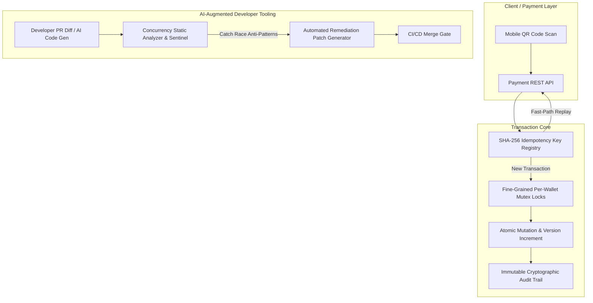

# Concurrency Guard Engine

> **High-Concurrency Financial Ledger, Race Condition Elimination & AI-Augmented CI/CD Code Sentinel**  
> *Engineered by Paul Trafford ([@elura172](https://github.com/elura172)) · Tokyo Relocation Pipeline Candidate*

[](https://www.python.org/)
[](LICENSE)
[-brightgreen.svg)](#evaluation-benchmark)
[](#the-problem-concurrency-at-paypay-scale)

---

## The Problem: Concurrency at PayPay Scale & AI-First Developer Speed

At nationwide financial scale (processing tens of millions of QR payment transactions per day across Japan), maintaining strict **at-most-once execution** and **zero balance drift** under high concurrency is paramount.

Simultaneously, engineering organizations are mandating **"AI-first development"**, encouraging developers to leverage LLMs, Copilots, and autonomous coding agents. While this accelerates velocity, AI-generated backend code frequently introduces subtle financial race conditions:

1. **Non-Atomic Balance Checks:** Reading wallet balances without pessimistic row-level locks (`SELECT ... FOR UPDATE`), leading to double-spend vulnerabilities under concurrent checkout bursts.
2. **Missing Endpoint Idempotency:** Payment endpoints lacking strict `Idempotency-Key` validation, causing duplicate debits during network retries or double QR code scans.
3. **Thundering Herd Retries:** Naive fixed-interval retry loops (`time.sleep(1)`) overwhelming downstream payment switches.
4. **Unrolled Exceptions:** Catch blocks swallowing database exceptions without issuing explicit rollbacks, leaking dirty session states.

**Concurrency Guard Engine** solves both sides of this equation: providing an **atomic, lock-guarded transactional ledger** and an **automated CI/CD code sentinel** that catches concurrency anti-patterns in pull requests and generates automated patches.

---

## Architectural Overview



---

## Core Capabilities

### 1. High-Concurrency Transactional Ledger
* **Fine-Grained Mutex Locking:** Per-wallet lock registry preventing parallel worker threads from modifying a single balance simultaneously.
* **Dual Concurrency Guards:** Combines pessimistic row-level locking with optimistic version counters (`version += 1`).
* **Zero Double-Spends:** Verified under 50-thread concurrent contention bursts where multiple parallel requests race to drain a wallet.

### 2. Fast-Path Idempotency Registry
* **Instant Replay:** Returns verified prior execution states in $<0.1\text{ ms}$ on duplicate QR scans or network retries without touching balance rows.
* **Tamper Detection:** Automatically rejects requests reusing an existing idempotency key with modified amounts as `CONFLICT`.

### 3. AI-Augmented Static Code Sentinel
* **CI/CD Quality Gate:** Analyzes pull request code diffs for financial anti-patterns:
  * `PAY-001`: Unguarded balance read (missing `FOR UPDATE`).
  * `PAY-002`: Missing `Idempotency-Key` validation on mutation endpoints.
  * `PAY-003`: Fixed-interval retries lacking exponential backoff and jitter.
  * `PAY-004`: Exception blocks lacking explicit `db.rollback()`.
* **Automated Remediation:** Generates syntax-checked drop-in patches directly in the review output.

---

## Evaluation Benchmark

The repository includes a 10-scenario canonical benchmark suite testing transaction integrity, contention bursts, and sentinel accuracy:

| Scenario | Objective | Status Detail | Result |
|---|---|---|---|
| `01_PARALLEL_BURST_CONTENTION_RACE` | 50 concurrent worker threads race on ¥10,000 balance | 10 settled / 40 rejected (balance: ¥0) | **PASS** |
| `02_IDEMPOTENT_DUPLICATE_QR_REPLAY` | Duplicate QR scan returns cached result without double debit | Verified prior settlement | **PASS** |
| `03_IDEMPOTENCY_PAYLOAD_TAMPER_CONFLICT` | Idempotency key reused with altered amount rejected | Rejected as CONFLICT | **PASS** |
| `04_INSUFFICIENT_FUNDS_SAFETY_REJECTION` | Overdraft attempt rejected cleanly without balance drift | Status: INSUFFICIENT_FUNDS | **PASS** |
| `05_SENTINEL_UNGUARDED_BALANCE_READ` | Code review bot catches missing `FOR UPDATE` lock | Caught Rule PAY-001 | **PASS** |
| `06_SENTINEL_NON_IDEMPOTENT_ENDPOINT` | CI bot flags endpoint missing Idempotency-Key header | Caught Rule PAY-002 | **PASS** |
| `07_SENTINEL_THUNDERING_HERD_RETRY` | CI bot detects retry loop without exponential backoff & jitter | Caught Rule PAY-003 | **PASS** |
| `08_SENTINEL_MISSING_TRANSACTION_ROLLBACK` | CI bot flags exception block lacking explicit db.rollback() | Caught Rule PAY-004 | **PASS** |
| `09_SENTINEL_CLEAN_DIFF_APPROVAL` | Verified idiomatic code with locks approved for merge | Status: safe_to_merge=True | **PASS** |
| `10_IMMUTABLE_AUDIT_VERSIONING` | Every atomic debit writes version increment and SHA-256 hash | Verified version & audit log | **PASS** |

**Benchmark Score:** **10 / 10 Passing (100.0%)**

---

## Quickstart

### Prerequisites
* Python 3.11+
* [`uv`](https://github.com/astral-sh/uv) (recommended) or `pip`

### 1. Run Interactive Terminal Demo
Experience live 50-thread contention bursts, automated PR vulnerability scanning, and benchmark evals:
```bash
git clone https://github.com/elura172/concurrency-guard-engine.git
cd concurrency-guard-engine
uv run demo.py
```

### 2. Run Test Suite
```bash
uv run pytest -v
```

---

## Project Structure

```
concurrency-guard-engine/
├── demo.py                   # Rich terminal demo showing live 50-thread burst & sentinel
├── pyproject.toml            # Project specification & uv dependencies
├── README.md                 # System documentation & benchmark scorecard
├── src/
│   ├── models/
│   │   └── types.py          # Wallet schemas, payment transactions, vulnerability rules
│   ├── engine/
│   │   └── ledger.py         # High-concurrency ledger, mutex locks & idempotency
│   ├── sentinel/
│   │   └── analyzer.py       # Static code analyzer, concurrency rules & automated patches
│   └── evals/
│       └── harness.py        # 10-scenario canonical evaluation suite
└── tests/
    └── test_concurrency.py   # Unit and integration pytest suite
```

---

## Author & Contact

**Paul Trafford**  
*AI Systems & Backend Infrastructure Engineer*  
* **GitHub:** [github.com/elura172](https://github.com/elura172)  
* **Email:** [paul.trafford@protonmail.com](mailto:paul.trafford@protonmail.com)  
* **Target:** Tokyo Relocation Pipeline / PayPay Core Backend Engineering
